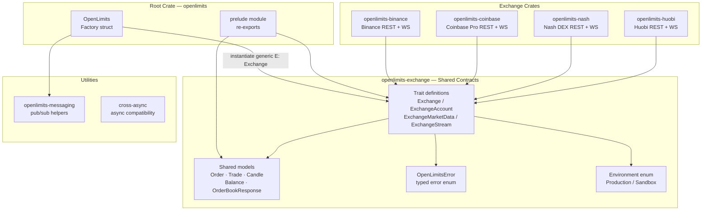
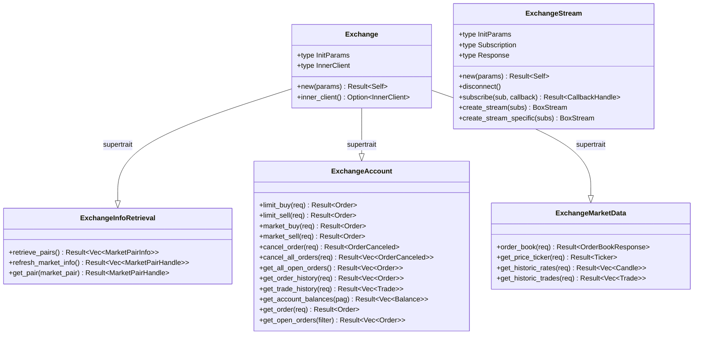
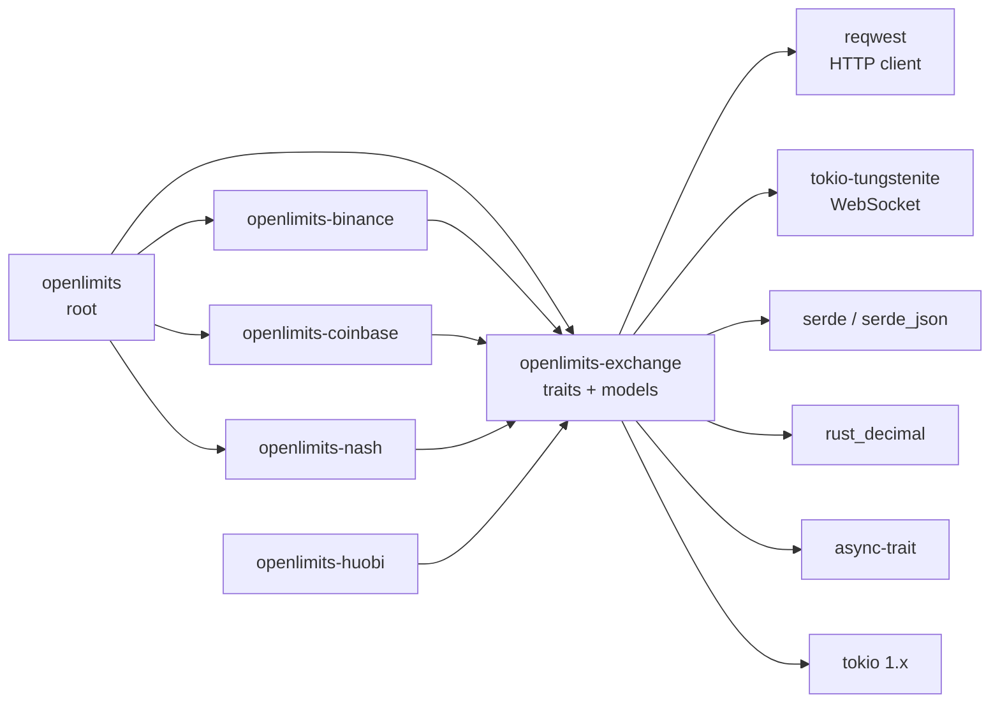

> Historical archive captured 2026-10-13 from source base `ef076a6f7e7b9cffbdc1d848a31636c50ac5f6c5`. Original document SHA256: `b8c1af9fc234b4e1f14f689bfc07bac023e813df45f9500d955be2bdad5ac56e`. This superseded guide is not evidence of current capability support. Use [the source-reviewed guide](../ayu-develop.md).

# OpenLimits — Architecture

> **Last Updated**: 2026-04-07T00:00:00Z
> **Git Hash**: `4137b08`

## System Architecture Overview

OpenLimits organizes into a Cargo workspace where a single set of shared traits and models lives in `openlimits-exchange`, and each exchange is an independent crate that implements those traits. The root `openlimits` crate re-exports everything through a convenience prelude.



## Trading Paradigm & Key Features

| Dimension | Detail |
|---|---|
| **Paradigm** | Async trait-based exchange abstraction |
| **Concurrency Model** | Tokio async/await; WebSocket streams run in spawned tasks |
| **Decimal Arithmetic** | `rust_decimal::Decimal` — no IEEE 754 float errors |
| **REST Client** | `reqwest` with HMAC-SHA256 request signing |
| **WebSocket Client** | `tokio-tungstenite` wrapped in `ExchangeStream` trait |
| **Serialization** | `serde` / `serde_json` with exchange-specific rename conventions |
| **Error Model** | `OpenLimitsError` enum, propagated as `Result<T, OpenLimitsError>` |
| **Environment** | Production and Sandbox per exchange |
| **Language Bindings** | Optional C# bindings via `bindings/` crate |
| **Supported Spot Markets** | Binance, Coinbase Pro, Nash DEX, Huobi |

## Trait Hierarchy



Source references:
- `Exchange` supertrait: `ext-systems/openlimits/crates/openlimits-exchange/src/traits/exchange.rs`
- `ExchangeAccount`: `ext-systems/openlimits/crates/openlimits-exchange/src/traits/exchange_account.rs`
- `ExchangeMarketData`: `ext-systems/openlimits/crates/openlimits-exchange/src/traits/exchange_market_data.rs`
- `ExchangeStream`: `ext-systems/openlimits/crates/openlimits-exchange/src/traits/stream/exchange_stream.rs`
- Trait module root: `ext-systems/openlimits/crates/openlimits-exchange/src/traits/mod.rs`

## Core Components

### openlimits-exchange — Shared Contracts

The foundation crate. It contains no HTTP code — only types and async trait definitions that all exchange crates must implement.

| Module | Path | Purpose |
|---|---|---|
| `traits` | `crates/openlimits-exchange/src/traits/` | `Exchange`, `ExchangeAccount`, `ExchangeMarketData`, `ExchangeStream` |
| `model` | `crates/openlimits-exchange/src/model/` | All shared data types |
| `errors` | `crates/openlimits-exchange/src/errors.rs` | `OpenLimitsError` enum and `Result<T>` alias |
| `exchange` | `crates/openlimits-exchange/src/exchange.rs` | `Environment` enum (Production / Sandbox) |
| `shared` | `crates/openlimits-exchange/src/shared.rs` | Shared utilities and `Result` type alias |

### openlimits-binance — Binance Integration

Implements all exchange traits for the Binance Spot API.

| Component | Path | Role |
|---|---|---|
| `Binance` struct | `crates/openlimits-binance/src/lib.rs` | Trait impl entry point |
| `BaseClient` | `crates/openlimits-binance/src/client/base_client.rs` | Raw HTTP calls |
| `Transport` | `crates/openlimits-binance/src/transport.rs` | HMAC-SHA256 signing, reqwest client |
| `BinanceWebsocket` | `crates/openlimits-binance/src/client/stream.rs` | WebSocket stream impl |
| `BinanceParameters` | `crates/openlimits-binance/src/binance_parameters.rs` | Init config (env + credentials) |
| `BinanceCredentials` | `crates/openlimits-binance/src/binance_credentials.rs` | API key + secret |

### openlimits-coinbase — Coinbase Pro Integration

Implements the same traits for Coinbase Pro (now Advanced Trade). The `CoinbaseWebsocket` is used in the `orderbook.rs` example.

### openlimits-nash — Nash DEX Integration

Supports the Nash non-custodial exchange. Has optional `rust_gmp` / `num_bigint` features for cryptographic operations required by the Nash protocol.

### Root Crate — openlimits

```
src/
├── lib.rs        — re-exports exchange, prelude, model, errors
├── openlimits.rs — OpenLimits factory (instantiate<E: Exchange>)
├── exchange/     — re-exports of exchange-specific modules
└── prelude/      — convenience glob imports
```

Source: `ext-systems/openlimits/src/lib.rs`, `ext-systems/openlimits/src/openlimits.rs`

## Module Dependency Diagram



## See Also

- [workflow.md](../workflow.md) — order execution and WebSocket subscription flows
- [state-management.md](../state-management.md) — model types and state representation
- [development.md](../development.md) — build instructions and troubleshooting
