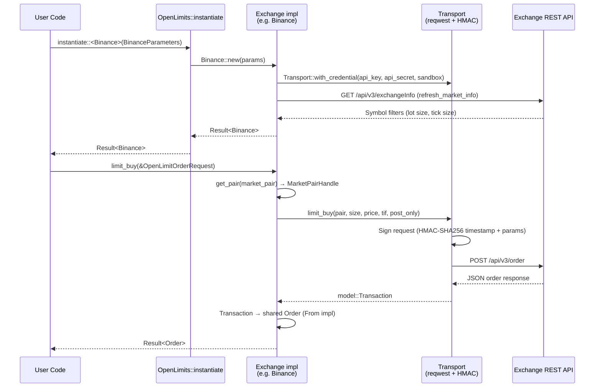
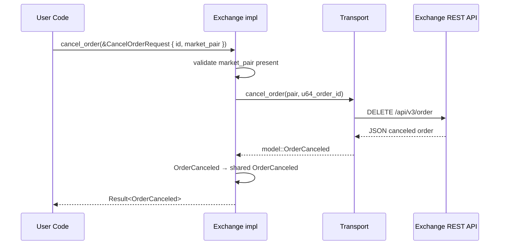
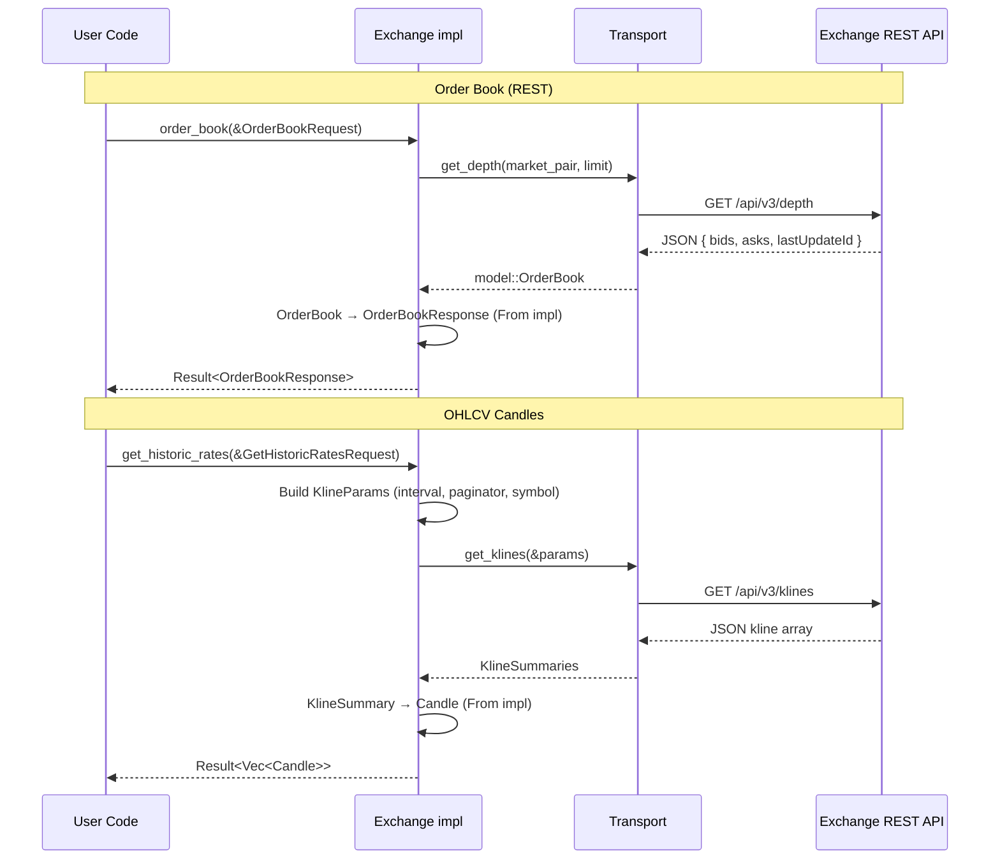
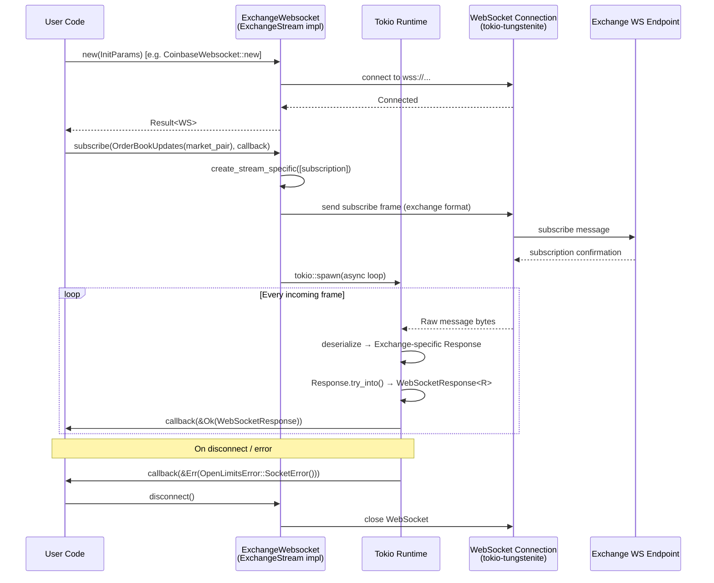

> Historical archive captured 2026-10-13 from source base `ef076a6f7e7b9cffbdc1d848a31636c50ac5f6c5`. Original document SHA256: `5e7acb33d34b1337ea08466b9a5b7db84acef11cdec678266f22c9882e21485d`. This superseded guide is not evidence of current capability support. Use [the source-reviewed guide](../ayu-develop.md).

# OpenLimits — Workflow

> **Last Updated**: 2026-04-07T00:00:00Z
> **Git Hash**: `4137b08`

## Order Execution Flow

This sequence covers how a `limit_buy` call travels from user code through the trait layer to the exchange REST API and back.

Source references:
- `ExchangeAccount::limit_buy`: `ext-systems/openlimits/crates/openlimits-exchange/src/traits/exchange_account.rs`
- Binance implementation: `ext-systems/openlimits/crates/openlimits-binance/src/lib.rs`
- `Transport` (signing): `ext-systems/openlimits/crates/openlimits-binance/src/transport.rs`
- `OpenLimits::instantiate`: `ext-systems/openlimits/src/openlimits.rs`

## Order Cancellation Flow

Source: `ext-systems/openlimits/crates/openlimits-binance/src/lib.rs` (lines 214–229)

## Market Data Flow

Source: `ext-systems/openlimits/crates/openlimits-exchange/src/traits/exchange_market_data.rs`

## WebSocket Subscription Flow

Source references:
- `ExchangeStream` trait: `ext-systems/openlimits/crates/openlimits-exchange/src/traits/stream/exchange_stream.rs`
- `Subscriptions` wrapper: `ext-systems/openlimits/crates/openlimits-exchange/src/traits/stream/subscriptions.rs`
- `CallbackHandle`: `ext-systems/openlimits/crates/openlimits-exchange/src/traits/stream/callback_handle.rs`
- Orderbook example: `ext-systems/openlimits/examples/rust/orderbook.rs`
- WebSocket message types: `ext-systems/openlimits/crates/openlimits-exchange/src/model/websocket.rs`

## Exchange Initialization Flow

Each exchange crate follows this initialization pattern:

1. User calls `OpenLimits::instantiate::<E>(params)`.
2. The library calls `E::new(params)` which constructs an HTTP `Transport` with optional HMAC credentials.
3. `refresh_market_info()` is called immediately to populate the local `ExchangeInfo` cache (market pairs, lot sizes, tick sizes).
4. The initialized exchange struct is returned to the user.

This eager fetch ensures that all subsequent `get_pair()` lookups are synchronous reads from the in-memory cache rather than additional network calls.

Source: `ext-systems/openlimits/crates/openlimits-binance/src/lib.rs` (Binance::new impl)

## See Also

- [architecture.md](../architecture.md) — trait hierarchy and crate layout
- [state-management.md](../state-management.md) — data models used in these flows
- [development.md](../development.md) — environment setup for running examples
