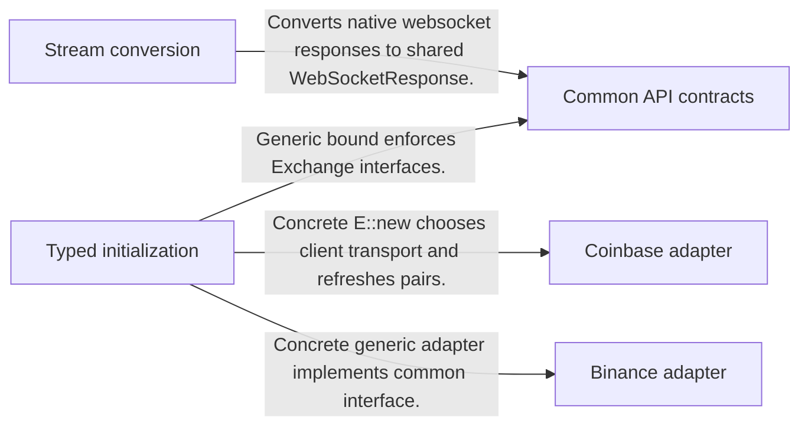
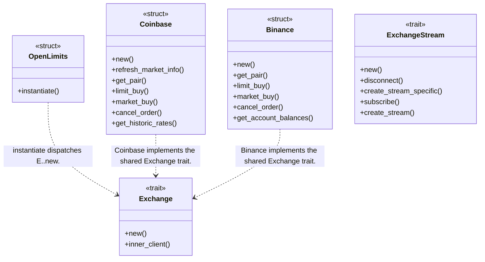
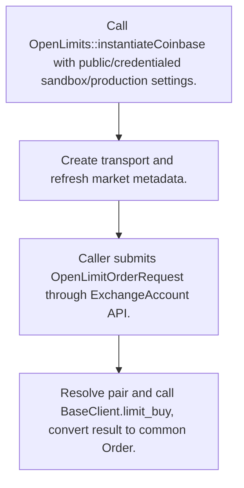
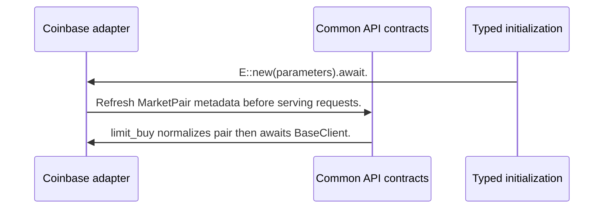

# OpenLimits: workflow, design and architecture

Updated: **2026-10-13**
Reviewed Git hash: `ef076a6f7e7b9cffbdc1d848a31636c50ac5f6c5`
Branch: `feature/ayu_develop`
Source diff SHA256: `e3b0c44298fc1c149afbf4c8996fb92427ae41e4649b934ca495991b7852b855`
Scope: **Execution adapter toolkit** / Maintenance: **active**
Languages: Rust

[HTML edition](ayu-develop.html) / [Development](development.md) / [Historical validation](validation.md) / [Full system comparison](../../docs/index.html)

## Purpose and scope

Common asynchronous crypto exchange account/market/stream traits implemented by Binance, Coinbase and Nash adapters; no native strategy/backtest orchestration.

## Features and support boundaries

Native = implemented here. Integration = supplied through a named host/API. Limited = material restriction. Not provided = evidenced scope exclusion. Unverified = support/absence not established. Not applicable = outside this artifact type.

| Capability | Status | Implementation and limits | Source |
|---|---|---|---|
| Backtesting | Unverified | Not established by the inspected implementation boundaries; no absence or production claim is made. | Not applicable to this repository scope. |
| Live execution | Native | Concrete adapters expose remote market/limit/cancel, balances and order history through shared traits; implementation presence is separate from live-account verification. | [limit_buy](../crates/openlimits-coinbase/src/lib.rs) ([L212](https://github.com/alexcwyu/openlimits/blob/ef076a6f7e7b9cffbdc1d848a31636c50ac5f6c5/crates/openlimits-coinbase/src/lib.rs#L212)) / [Binance](../crates/openlimits-binance/src/lib.rs) ([L46](https://github.com/alexcwyu/openlimits/blob/ef076a6f7e7b9cffbdc1d848a31636c50ac5f6c5/crates/openlimits-binance/src/lib.rs#L46)) / [Exchange](../crates/openlimits-exchange/src/traits/exchange.rs) ([L8](https://github.com/alexcwyu/openlimits/blob/ef076a6f7e7b9cffbdc1d848a31636c50ac5f6c5/crates/openlimits-exchange/src/traits/exchange.rs#L8)) / [src/exchange/mod.rs](../src/exchange/mod.rs) ([L3](https://github.com/alexcwyu/openlimits/blob/ef076a6f7e7b9cffbdc1d848a31636c50ac5f6c5/src/exchange/mod.rs#L3)) |
| Paper trading | Integration | Sandbox chooses an exchange-hosted environment; no in-process paper brokerage was inspected. | [Environment](../crates/openlimits-exchange/src/exchange.rs) ([L13](https://github.com/alexcwyu/openlimits/blob/ef076a6f7e7b9cffbdc1d848a31636c50ac5f6c5/crates/openlimits-exchange/src/exchange.rs#L13)) / [Coinbase](../crates/openlimits-coinbase/src/lib.rs) ([L67](https://github.com/alexcwyu/openlimits/blob/ef076a6f7e7b9cffbdc1d848a31636c50ac5f6c5/crates/openlimits-coinbase/src/lib.rs#L67)) |
| Event driven | Native | ExchangeStream creates converted event streams and callback consumer tasks. | [ExchangeStream](../crates/openlimits-exchange/src/traits/stream/exchange_stream.rs) ([L17](https://github.com/alexcwyu/openlimits/blob/ef076a6f7e7b9cffbdc1d848a31636c50ac5f6c5/crates/openlimits-exchange/src/traits/stream/exchange_stream.rs#L17)) |
| Vectorized | Unverified | Not established by the inspected implementation boundaries; no absence or production claim is made. | Not applicable to this repository scope. |
| Order management | Native | Concrete adapters expose remote market/limit/cancel, balances and order history through shared traits; implementation presence is separate from live-account verification. | [limit_buy](../crates/openlimits-coinbase/src/lib.rs) ([L212](https://github.com/alexcwyu/openlimits/blob/ef076a6f7e7b9cffbdc1d848a31636c50ac5f6c5/crates/openlimits-coinbase/src/lib.rs#L212)) / [Binance](../crates/openlimits-binance/src/lib.rs) ([L46](https://github.com/alexcwyu/openlimits/blob/ef076a6f7e7b9cffbdc1d848a31636c50ac5f6c5/crates/openlimits-binance/src/lib.rs#L46)) / [Exchange](../crates/openlimits-exchange/src/traits/exchange.rs) ([L8](https://github.com/alexcwyu/openlimits/blob/ef076a6f7e7b9cffbdc1d848a31636c50ac5f6c5/crates/openlimits-exchange/src/traits/exchange.rs#L8)) / [src/exchange/mod.rs](../src/exchange/mod.rs) ([L3](https://github.com/alexcwyu/openlimits/blob/ef076a6f7e7b9cffbdc1d848a31636c50ac5f6c5/src/exchange/mod.rs#L3)) |
| Order types | Native | Concrete adapters expose remote market/limit/cancel, balances and order history through shared traits; implementation presence is separate from live-account verification. | [limit_buy](../crates/openlimits-coinbase/src/lib.rs) ([L212](https://github.com/alexcwyu/openlimits/blob/ef076a6f7e7b9cffbdc1d848a31636c50ac5f6c5/crates/openlimits-coinbase/src/lib.rs#L212)) / [Binance](../crates/openlimits-binance/src/lib.rs) ([L46](https://github.com/alexcwyu/openlimits/blob/ef076a6f7e7b9cffbdc1d848a31636c50ac5f6c5/crates/openlimits-binance/src/lib.rs#L46)) / [Exchange](../crates/openlimits-exchange/src/traits/exchange.rs) ([L8](https://github.com/alexcwyu/openlimits/blob/ef076a6f7e7b9cffbdc1d848a31636c50ac5f6c5/crates/openlimits-exchange/src/traits/exchange.rs#L8)) / [src/exchange/mod.rs](../src/exchange/mod.rs) ([L3](https://github.com/alexcwyu/openlimits/blob/ef076a6f7e7b9cffbdc1d848a31636c50ac5f6c5/src/exchange/mod.rs#L3)) |
| Multi venue | Native | Concrete adapters expose remote market/limit/cancel, balances and order history through shared traits; implementation presence is separate from live-account verification. | [limit_buy](../crates/openlimits-coinbase/src/lib.rs) ([L212](https://github.com/alexcwyu/openlimits/blob/ef076a6f7e7b9cffbdc1d848a31636c50ac5f6c5/crates/openlimits-coinbase/src/lib.rs#L212)) / [Binance](../crates/openlimits-binance/src/lib.rs) ([L46](https://github.com/alexcwyu/openlimits/blob/ef076a6f7e7b9cffbdc1d848a31636c50ac5f6c5/crates/openlimits-binance/src/lib.rs#L46)) / [Exchange](../crates/openlimits-exchange/src/traits/exchange.rs) ([L8](https://github.com/alexcwyu/openlimits/blob/ef076a6f7e7b9cffbdc1d848a31636c50ac5f6c5/crates/openlimits-exchange/src/traits/exchange.rs#L8)) / [src/exchange/mod.rs](../src/exchange/mod.rs) ([L3](https://github.com/alexcwyu/openlimits/blob/ef076a6f7e7b9cffbdc1d848a31636c50ac5f6c5/src/exchange/mod.rs#L3)) |
| Crypto | Native | Concrete adapters expose remote market/limit/cancel, balances and order history through shared traits; implementation presence is separate from live-account verification. | [limit_buy](../crates/openlimits-coinbase/src/lib.rs) ([L212](https://github.com/alexcwyu/openlimits/blob/ef076a6f7e7b9cffbdc1d848a31636c50ac5f6c5/crates/openlimits-coinbase/src/lib.rs#L212)) / [Binance](../crates/openlimits-binance/src/lib.rs) ([L46](https://github.com/alexcwyu/openlimits/blob/ef076a6f7e7b9cffbdc1d848a31636c50ac5f6c5/crates/openlimits-binance/src/lib.rs#L46)) / [Exchange](../crates/openlimits-exchange/src/traits/exchange.rs) ([L8](https://github.com/alexcwyu/openlimits/blob/ef076a6f7e7b9cffbdc1d848a31636c50ac5f6c5/crates/openlimits-exchange/src/traits/exchange.rs#L8)) / [src/exchange/mod.rs](../src/exchange/mod.rs) ([L3](https://github.com/alexcwyu/openlimits/blob/ef076a6f7e7b9cffbdc1d848a31636c50ac5f6c5/src/exchange/mod.rs#L3)) |
| Equities | Unverified | Not established by the inspected implementation boundaries; no absence or production claim is made. | Not applicable to this repository scope. |
| Futures | Unverified | Not established by the inspected implementation boundaries; no absence or production claim is made. | Not applicable to this repository scope. |
| Options | Unverified | Not established by the inspected implementation boundaries; no absence or production claim is made. | Not applicable to this repository scope. |
| Forex | Unverified | Not established by the inspected implementation boundaries; no absence or production claim is made. | Not applicable to this repository scope. |
| Strategy api | Unverified | Not established by the inspected implementation boundaries; no absence or production claim is made. | Not applicable to this repository scope. |
| Optimization | Unverified | Not established by the inspected implementation boundaries; no absence or production claim is made. | Not applicable to this repository scope. |
| Machine learning | Unverified | Not established by the inspected implementation boundaries; no absence or production claim is made. | Not applicable to this repository scope. |
| Reinforcement learning | Unverified | Not established by the inspected implementation boundaries; no absence or production claim is made. | Not applicable to this repository scope. |
| Portfolio | Unverified | Not established by the inspected implementation boundaries; no absence or production claim is made. | Not applicable to this repository scope. |
| Risk management | Unverified | Not established by the inspected implementation boundaries; no absence or production claim is made. | Not applicable to this repository scope. |
| Performance analytics | Unverified | Not established by the inspected implementation boundaries; no absence or production claim is made. | Not applicable to this repository scope. |
| Historical data | Limited | Coinbase candle retrieval is implemented, but its historical-trades method is unimplemented; adapter coverage is uneven. | [get_historic_rates](../crates/openlimits-coinbase/src/lib.rs) ([L150](https://github.com/alexcwyu/openlimits/blob/ef076a6f7e7b9cffbdc1d848a31636c50ac5f6c5/crates/openlimits-coinbase/src/lib.rs#L150)) |
| Streaming data | Native | ExchangeStream creates converted event streams and callback consumer tasks. | [ExchangeStream](../crates/openlimits-exchange/src/traits/stream/exchange_stream.rs) ([L17](https://github.com/alexcwyu/openlimits/blob/ef076a6f7e7b9cffbdc1d848a31636c50ac5f6c5/crates/openlimits-exchange/src/traits/stream/exchange_stream.rs#L17)) |
| Persistence | Unverified | Not established by the inspected implementation boundaries; no absence or production claim is made. | Not applicable to this repository scope. |
| Data pipeline | Limited | Normalizes market/order/stream responses without supplying a historical storage/research pipeline. | [limit_buy](../crates/openlimits-coinbase/src/lib.rs) ([L212](https://github.com/alexcwyu/openlimits/blob/ef076a6f7e7b9cffbdc1d848a31636c50ac5f6c5/crates/openlimits-coinbase/src/lib.rs#L212)) / [ExchangeStream](../crates/openlimits-exchange/src/traits/stream/exchange_stream.rs) ([L17](https://github.com/alexcwyu/openlimits/blob/ef076a6f7e7b9cffbdc1d848a31636c50ac5f6c5/crates/openlimits-exchange/src/traits/stream/exchange_stream.rs#L17)) |
| Web ui | Unverified | Not established by the inspected implementation boundaries; no absence or production claim is made. | Not applicable to this repository scope. |
| Cli | Unverified | Not established by the inspected implementation boundaries; no absence or production claim is made. | Not applicable to this repository scope. |
| Monitoring | Unverified | Not established by the inspected implementation boundaries; no absence or production claim is made. | Not applicable to this repository scope. |
| Extension api | Native | Concrete adapters expose remote market/limit/cancel, balances and order history through shared traits; implementation presence is separate from live-account verification. | [limit_buy](../crates/openlimits-coinbase/src/lib.rs) ([L212](https://github.com/alexcwyu/openlimits/blob/ef076a6f7e7b9cffbdc1d848a31636c50ac5f6c5/crates/openlimits-coinbase/src/lib.rs#L212)) / [Binance](../crates/openlimits-binance/src/lib.rs) ([L46](https://github.com/alexcwyu/openlimits/blob/ef076a6f7e7b9cffbdc1d848a31636c50ac5f6c5/crates/openlimits-binance/src/lib.rs#L46)) / [Exchange](../crates/openlimits-exchange/src/traits/exchange.rs) ([L8](https://github.com/alexcwyu/openlimits/blob/ef076a6f7e7b9cffbdc1d848a31636c50ac5f6c5/crates/openlimits-exchange/src/traits/exchange.rs#L8)) / [src/exchange/mod.rs](../src/exchange/mod.rs) ([L3](https://github.com/alexcwyu/openlimits/blob/ef076a6f7e7b9cffbdc1d848a31636c50ac5f6c5/src/exchange/mod.rs#L3)) |
| Native acceleration | Native | Adapters and trait implementations compile in Rust. | [Exchange](../crates/openlimits-exchange/src/traits/exchange.rs) ([L8](https://github.com/alexcwyu/openlimits/blob/ef076a6f7e7b9cffbdc1d848a31636c50ac5f6c5/crates/openlimits-exchange/src/traits/exchange.rs#L8)) / [Coinbase](../crates/openlimits-coinbase/src/lib.rs) ([L67](https://github.com/alexcwyu/openlimits/blob/ef076a6f7e7b9cffbdc1d848a31636c50ac5f6c5/crates/openlimits-coinbase/src/lib.rs#L67)) |
| Distributed execution | Unverified | Not established by the inspected implementation boundaries; no absence or production claim is made. | Not applicable to this repository scope. |

## System components

| Component | Responsibility | Source |
|---|---|---|
| Typed initialization | Instantiates the chosen generic exchange. | [OpenLimits](../src/openlimits.rs) ([L10](https://github.com/alexcwyu/openlimits/blob/ef076a6f7e7b9cffbdc1d848a31636c50ac5f6c5/src/openlimits.rs#L10)) / [Exchange](../crates/openlimits-exchange/src/traits/exchange.rs) ([L8](https://github.com/alexcwyu/openlimits/blob/ef076a6f7e7b9cffbdc1d848a31636c50ac5f6c5/crates/openlimits-exchange/src/traits/exchange.rs#L8)) |
| Common API contracts | Shared account, market-info and market-data traits/models. | [Exchange](../crates/openlimits-exchange/src/traits/exchange.rs) ([L8](https://github.com/alexcwyu/openlimits/blob/ef076a6f7e7b9cffbdc1d848a31636c50ac5f6c5/crates/openlimits-exchange/src/traits/exchange.rs#L8)) |
| Coinbase adapter | Maps normalized market/order requests to Coinbase BaseClient. | [Coinbase](../crates/openlimits-coinbase/src/lib.rs) ([L67](https://github.com/alexcwyu/openlimits/blob/ef076a6f7e7b9cffbdc1d848a31636c50ac5f6c5/crates/openlimits-coinbase/src/lib.rs#L67)) / [limit_buy](../crates/openlimits-coinbase/src/lib.rs) ([L212](https://github.com/alexcwyu/openlimits/blob/ef076a6f7e7b9cffbdc1d848a31636c50ac5f6c5/crates/openlimits-coinbase/src/lib.rs#L212)) / [get_historic_rates](../crates/openlimits-coinbase/src/lib.rs) ([L150](https://github.com/alexcwyu/openlimits/blob/ef076a6f7e7b9cffbdc1d848a31636c50ac5f6c5/crates/openlimits-coinbase/src/lib.rs#L150)) |
| Binance adapter | Implements common exchange requests for Binance. | [Binance](../crates/openlimits-binance/src/lib.rs) ([L46](https://github.com/alexcwyu/openlimits/blob/ef076a6f7e7b9cffbdc1d848a31636c50ac5f6c5/crates/openlimits-binance/src/lib.rs#L46)) |
| Stream conversion | Converts exchange events and invokes callback/stream consumers. | [ExchangeStream](../crates/openlimits-exchange/src/traits/stream/exchange_stream.rs) ([L17](https://github.com/alexcwyu/openlimits/blob/ef076a6f7e7b9cffbdc1d848a31636c50ac5f6c5/crates/openlimits-exchange/src/traits/stream/exchange_stream.rs#L17)) |

## Architecture and component boundaries

The component view summarizes inspected responsibility boundaries. Arrows identify the documented API/data dependencies; this is not a deployment-readiness claim.

- Generic bound enforces Exchange interfaces.: [OpenLimits](../src/openlimits.rs) ([L10](https://github.com/alexcwyu/openlimits/blob/ef076a6f7e7b9cffbdc1d848a31636c50ac5f6c5/src/openlimits.rs#L10)) / [Exchange](../crates/openlimits-exchange/src/traits/exchange.rs) ([L8](https://github.com/alexcwyu/openlimits/blob/ef076a6f7e7b9cffbdc1d848a31636c50ac5f6c5/crates/openlimits-exchange/src/traits/exchange.rs#L8))
- Concrete E::new chooses client transport and refreshes pairs.: [OpenLimits](../src/openlimits.rs) ([L10](https://github.com/alexcwyu/openlimits/blob/ef076a6f7e7b9cffbdc1d848a31636c50ac5f6c5/src/openlimits.rs#L10)) / [Coinbase](../crates/openlimits-coinbase/src/lib.rs) ([L67](https://github.com/alexcwyu/openlimits/blob/ef076a6f7e7b9cffbdc1d848a31636c50ac5f6c5/crates/openlimits-coinbase/src/lib.rs#L67))
- Concrete generic adapter implements common interface.: [OpenLimits](../src/openlimits.rs) ([L10](https://github.com/alexcwyu/openlimits/blob/ef076a6f7e7b9cffbdc1d848a31636c50ac5f6c5/src/openlimits.rs#L10)) / [Binance](../crates/openlimits-binance/src/lib.rs) ([L46](https://github.com/alexcwyu/openlimits/blob/ef076a6f7e7b9cffbdc1d848a31636c50ac5f6c5/crates/openlimits-binance/src/lib.rs#L46))
- Converts native websocket responses to shared WebSocketResponse.: [ExchangeStream](../crates/openlimits-exchange/src/traits/stream/exchange_stream.rs) ([L17](https://github.com/alexcwyu/openlimits/blob/ef076a6f7e7b9cffbdc1d848a31636c50ac5f6c5/crates/openlimits-exchange/src/traits/stream/exchange_stream.rs#L17))

## Design decisions

| Decision | Rationale | Tradeoff | Evidence |
|---|---|---|---|
| Expose a composed Exchange trait with exchange-specific clients. | Common requests/results are portable while inner clients retain venue-specific features. | Adapters implement different subsets; common trait membership does not mean identical feature coverage. | [Exchange](../crates/openlimits-exchange/src/traits/exchange.rs) ([L8](https://github.com/alexcwyu/openlimits/blob/ef076a6f7e7b9cffbdc1d848a31636c50ac5f6c5/crates/openlimits-exchange/src/traits/exchange.rs#L8)) / [get_historic_rates](../crates/openlimits-coinbase/src/lib.rs) ([L150](https://github.com/alexcwyu/openlimits/blob/ef076a6f7e7b9cffbdc1d848a31636c50ac5f6c5/crates/openlimits-coinbase/src/lib.rs#L150)) |
| Convert stream messages through TryInto and callbacks. | Common consumers can process different native websocket payloads. | Callback consumer ends on stream/socket failures; callers must manage lifecycle/recovery. | [ExchangeStream](../crates/openlimits-exchange/src/traits/stream/exchange_stream.rs) ([L17](https://github.com/alexcwyu/openlimits/blob/ef076a6f7e7b9cffbdc1d848a31636c50ac5f6c5/crates/openlimits-exchange/src/traits/stream/exchange_stream.rs#L17)) |

## Class and interface relationships

Each node is a reviewed source symbol. Function/module nodes are explicitly labeled; they do not imply Python classes. Only reviewed relationships are drawn.

- **OpenLimits** (struct): [OpenLimits](../src/openlimits.rs) ([L10](https://github.com/alexcwyu/openlimits/blob/ef076a6f7e7b9cffbdc1d848a31636c50ac5f6c5/src/openlimits.rs#L10))
- **Exchange** (trait): [Exchange](../crates/openlimits-exchange/src/traits/exchange.rs) ([L8](https://github.com/alexcwyu/openlimits/blob/ef076a6f7e7b9cffbdc1d848a31636c50ac5f6c5/crates/openlimits-exchange/src/traits/exchange.rs#L8))
- **Coinbase** (struct): [Coinbase](../crates/openlimits-coinbase/src/lib.rs) ([L67](https://github.com/alexcwyu/openlimits/blob/ef076a6f7e7b9cffbdc1d848a31636c50ac5f6c5/crates/openlimits-coinbase/src/lib.rs#L67)) / [limit_buy](../crates/openlimits-coinbase/src/lib.rs) ([L212](https://github.com/alexcwyu/openlimits/blob/ef076a6f7e7b9cffbdc1d848a31636c50ac5f6c5/crates/openlimits-coinbase/src/lib.rs#L212)) / [get_historic_rates](../crates/openlimits-coinbase/src/lib.rs) ([L150](https://github.com/alexcwyu/openlimits/blob/ef076a6f7e7b9cffbdc1d848a31636c50ac5f6c5/crates/openlimits-coinbase/src/lib.rs#L150))
- **Binance** (struct): [Binance](../crates/openlimits-binance/src/lib.rs) ([L46](https://github.com/alexcwyu/openlimits/blob/ef076a6f7e7b9cffbdc1d848a31636c50ac5f6c5/crates/openlimits-binance/src/lib.rs#L46))
- **ExchangeStream** (trait): [ExchangeStream](../crates/openlimits-exchange/src/traits/stream/exchange_stream.rs) ([L17](https://github.com/alexcwyu/openlimits/blob/ef076a6f7e7b9cffbdc1d848a31636c50ac5f6c5/crates/openlimits-exchange/src/traits/stream/exchange_stream.rs#L17))

## Workflow

### Initialize and submit a Coinbase limit buy

The external exchange is reached by BaseClient, not a native fill simulator. Actual order conversion is inspected; credentials or endpoint connectivity were not exercised in this audit.

1. Call OpenLimits::instantiate<Coinbase> with public/credentialed sandbox/production settings.. [OpenLimits](../src/openlimits.rs) ([L10](https://github.com/alexcwyu/openlimits/blob/ef076a6f7e7b9cffbdc1d848a31636c50ac5f6c5/src/openlimits.rs#L10)) / [Coinbase](../crates/openlimits-coinbase/src/lib.rs) ([L67](https://github.com/alexcwyu/openlimits/blob/ef076a6f7e7b9cffbdc1d848a31636c50ac5f6c5/crates/openlimits-coinbase/src/lib.rs#L67))
2. Create transport and refresh market metadata.. [Coinbase](../crates/openlimits-coinbase/src/lib.rs) ([L67](https://github.com/alexcwyu/openlimits/blob/ef076a6f7e7b9cffbdc1d848a31636c50ac5f6c5/crates/openlimits-coinbase/src/lib.rs#L67))
3. Caller submits OpenLimitOrderRequest through ExchangeAccount API.. [Exchange](../crates/openlimits-exchange/src/traits/exchange.rs) ([L8](https://github.com/alexcwyu/openlimits/blob/ef076a6f7e7b9cffbdc1d848a31636c50ac5f6c5/crates/openlimits-exchange/src/traits/exchange.rs#L8)) / [limit_buy](../crates/openlimits-coinbase/src/lib.rs) ([L212](https://github.com/alexcwyu/openlimits/blob/ef076a6f7e7b9cffbdc1d848a31636c50ac5f6c5/crates/openlimits-coinbase/src/lib.rs#L212))
4. Resolve pair and call BaseClient.limit_buy; convert result to common Order.. [limit_buy](../crates/openlimits-coinbase/src/lib.rs) ([L212](https://github.com/alexcwyu/openlimits/blob/ef076a6f7e7b9cffbdc1d848a31636c50ac5f6c5/crates/openlimits-coinbase/src/lib.rs#L212))

## Sequence

Initialize and submit a Coinbase limit buy

The external exchange is reached by BaseClient, not a native fill simulator. Actual order conversion is inspected; credentials or endpoint connectivity were not exercised in this audit.

- E::new(parameters).await.: [OpenLimits](../src/openlimits.rs) ([L10](https://github.com/alexcwyu/openlimits/blob/ef076a6f7e7b9cffbdc1d848a31636c50ac5f6c5/src/openlimits.rs#L10)) / [Coinbase](../crates/openlimits-coinbase/src/lib.rs) ([L67](https://github.com/alexcwyu/openlimits/blob/ef076a6f7e7b9cffbdc1d848a31636c50ac5f6c5/crates/openlimits-coinbase/src/lib.rs#L67))
- Refresh MarketPair metadata before serving requests.: [Coinbase](../crates/openlimits-coinbase/src/lib.rs) ([L67](https://github.com/alexcwyu/openlimits/blob/ef076a6f7e7b9cffbdc1d848a31636c50ac5f6c5/crates/openlimits-coinbase/src/lib.rs#L67))
- limit_buy normalizes pair then awaits BaseClient.: [limit_buy](../crates/openlimits-coinbase/src/lib.rs) ([L212](https://github.com/alexcwyu/openlimits/blob/ef076a6f7e7b9cffbdc1d848a31636c50ac5f6c5/crates/openlimits-coinbase/src/lib.rs#L212))

## Strengths and limits

### Strengths

- Normalized order requests map explicitly to client calls and typed results. [limit_buy](../crates/openlimits-coinbase/src/lib.rs) ([L212](https://github.com/alexcwyu/openlimits/blob/ef076a6f7e7b9cffbdc1d848a31636c50ac5f6c5/crates/openlimits-coinbase/src/lib.rs#L212))

### Limitations

- Sandbox is remote integration, and documented credential/TLS failures remain failures despite current exclusion policy. [Environment](../crates/openlimits-exchange/src/exchange.rs) ([L13](https://github.com/alexcwyu/openlimits/blob/ef076a6f7e7b9cffbdc1d848a31636c50ac5f6c5/crates/openlimits-exchange/src/exchange.rs#L13)) / [docs/validation.md](../docs/validation.md) ([L16](https://github.com/alexcwyu/openlimits/blob/ef076a6f7e7b9cffbdc1d848a31636c50ac5f6c5/docs/validation.md#L10))
- Huobi is absent from the supported root exports; Coinbase historical trades is unimplemented. [src/exchange/mod.rs](../src/exchange/mod.rs) ([L3](https://github.com/alexcwyu/openlimits/blob/ef076a6f7e7b9cffbdc1d848a31636c50ac5f6c5/src/exchange/mod.rs#L3)) / [get_historic_rates](../crates/openlimits-coinbase/src/lib.rs) ([L150](https://github.com/alexcwyu/openlimits/blob/ef076a6f7e7b9cffbdc1d848a31636c50ac5f6c5/crates/openlimits-coinbase/src/lib.rs#L150))

## Validation scope

The linked validation and command records preserve actual historical runs and user-authorized exclusions. This source/document review does not rerun application tests, establish live trading readiness or rank benchmark performance. Current data, credential and runtime prerequisites remain material.

[Repository validation](validation.md) / [Executed checks](maintenance/index.md)

## Source map

| Reviewed symbol/path | Inspected responsibility | Actual file SHA256 |
|---|---|---|
| [OpenLimits](../src/openlimits.rs) ([L10](https://github.com/alexcwyu/openlimits/blob/ef076a6f7e7b9cffbdc1d848a31636c50ac5f6c5/src/openlimits.rs#L10)) | instantiate calls E::new(parameters).await and returns the concrete Exchange. | `7c1f045de075517b1105e73592be55fcff55592b043f47e5bdce51ee88633af0` |
| [Exchange](../crates/openlimits-exchange/src/traits/exchange.rs) ([L8](https://github.com/alexcwyu/openlimits/blob/ef076a6f7e7b9cffbdc1d848a31636c50ac5f6c5/crates/openlimits-exchange/src/traits/exchange.rs#L8)) | Composes ExchangeInfoRetrieval, ExchangeAccount and ExchangeMarketData with async initialization and optional inner client. | `edc866fe089416332390b972d60e8cf5fcbaee56ace27e4ab977a80da2f20c71` |
| [Coinbase](../crates/openlimits-coinbase/src/lib.rs) ([L67](https://github.com/alexcwyu/openlimits/blob/ef076a6f7e7b9cffbdc1d848a31636c50ac5f6c5/crates/openlimits-coinbase/src/lib.rs#L67)) | Owns ExchangeInfo and BaseClient; new selects credentialed or public transport and sandbox flag before refresh_market_info. | `d02e2dcc1423d78bb82b3a5fc5a45921406295cb795a35cafff998f87475cc5b` |
| [limit_buy](../crates/openlimits-coinbase/src/lib.rs) ([L212](https://github.com/alexcwyu/openlimits/blob/ef076a6f7e7b9cffbdc1d848a31636c50ac5f6c5/crates/openlimits-coinbase/src/lib.rs#L212)) | Resolves a normalized MarketPair handle, passes size/price/TIF/post_only to BaseClient and converts response; cancel/market methods call the corresponding client methods. | `d02e2dcc1423d78bb82b3a5fc5a45921406295cb795a35cafff998f87475cc5b` |
| [get_historic_rates](../crates/openlimits-coinbase/src/lib.rs) ([L150](https://github.com/alexcwyu/openlimits/blob/ef076a6f7e7b9cffbdc1d848a31636c50ac5f6c5/crates/openlimits-coinbase/src/lib.rs#L150)) | Delegates historical candle requests to the client; get_historic_trades is unimplemented in the inspected adapter. | `d02e2dcc1423d78bb82b3a5fc5a45921406295cb795a35cafff998f87475cc5b` |
| [Binance](../crates/openlimits-binance/src/lib.rs) ([L46](https://github.com/alexcwyu/openlimits/blob/ef076a6f7e7b9cffbdc1d848a31636c50ac5f6c5/crates/openlimits-binance/src/lib.rs#L46)) | Concrete Binance adapter implements common market/account interfaces including limit/market requests and balances/orders. | `e7125f385d0ffdb382e8c1d67a0ef85e2b995faab64cb6ab03e5d84071479ad9` |
| [ExchangeStream](../crates/openlimits-exchange/src/traits/stream/exchange_stream.rs) ([L17](https://github.com/alexcwyu/openlimits/blob/ef076a6f7e7b9cffbdc1d848a31636c50ac5f6c5/crates/openlimits-exchange/src/traits/stream/exchange_stream.rs#L17)) | create_stream wraps native responses with TryInto; subscribe spawns a consumer task invoking callback and returns bounded CallbackHandle. | `6c81fec88aa09830ffaa1e7e1e97a404eabda4df9fb305755e1df88c89780bb3` |
| [src/exchange/mod.rs](../src/exchange/mod.rs) ([L3](https://github.com/alexcwyu/openlimits/blob/ef076a6f7e7b9cffbdc1d848a31636c50ac5f6c5/src/exchange/mod.rs#L3)) | Root exports Binance/Coinbase/Nash plus common trait/model/error modules; Huobi is not a supported root export. | `aefcd4e5543e9c4866bb03b047ee3d9aede693090a36c83076e09d1e741112ae` |
| [Environment](../crates/openlimits-exchange/src/exchange.rs) ([L13](https://github.com/alexcwyu/openlimits/blob/ef076a6f7e7b9cffbdc1d848a31636c50ac5f6c5/crates/openlimits-exchange/src/exchange.rs#L13)) | Production/Sandbox flags select remote environments; Sandbox is not an in-process paper fill engine. | `fd89fba6abce38c8b5c401274ee91ab40342ad71d384f98bccc212df9812550d` |
| [docs/validation.md](../docs/validation.md) ([L16](https://github.com/alexcwyu/openlimits/blob/ef076a6f7e7b9cffbdc1d848a31636c50ac5f6c5/docs/validation.md#L10)) | Current exclusions preserve credential/Nash TLS failures; supported native build and public checks do not prove private account execution. | `a43a0449c34d0387d451eb7b02f9996016388e586287187fb5734d738b2f0cfe` |

## Documentation provenance

Review date: 2026-10-13. Full committed source HEAD: `ef076a6f7e7b9cffbdc1d848a31636c50ac5f6c5`. Template version: 2. 8 source files were independently hashed for this guide.

[Evidence catalog](../../docs/systems-2026-10-13/catalog.json) / [Standard template](../../docs/guidelines/APP_TEMPLATE.md)

- Inspected source paths: src/openlimits.rs, crates/openlimits-exchange/src/traits/exchange.rs, crates/openlimits-coinbase/src/lib.rs, crates/openlimits-binance/src/lib.rs, crates/openlimits-exchange/src/traits/stream/exchange_stream.rs, src/exchange/mod.rs, crates/openlimits-exchange/src/exchange.rs, docs/validation.md
- Read-only audit against the full HEAD and tracked-diff provenance in inventory.json. Validation documentation is historical executed evidence; exclusions are completion policy, not live venue proof. No dependencies, tests or upstream files were changed.
