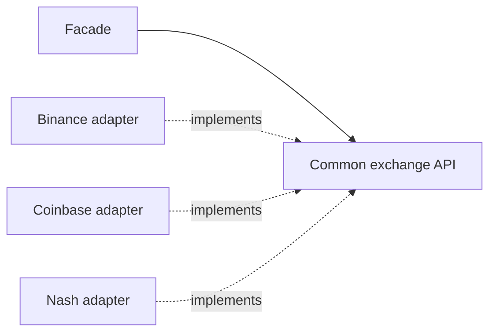
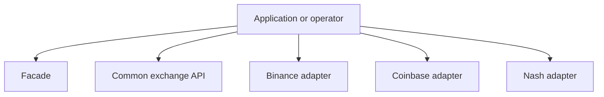
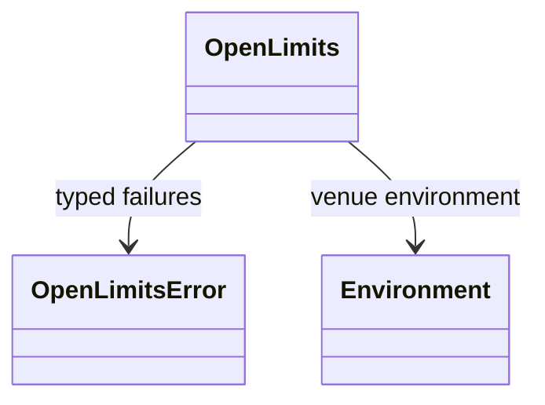
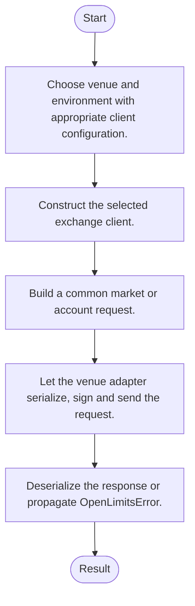
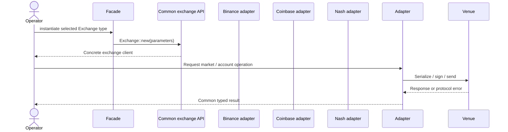
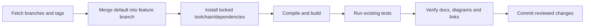

# openlimits: architecture, features and workflows

Updated: 2026-10-12 · Branch: `feature/ayu_develop` · Source snapshot: `41d02cb`

[Development and layout](development.md) · [Validation evidence](validation.md) · [HTML edition](ayu-develop.html)

## Purpose and scope

A Rust exchange API abstraction with Binance, Coinbase and Nash implementations and historical C# FFI bindings. OpenLimits is a stateless factory: instantiate<E: Exchange> returns the concrete venue client E. Venue adapters implement common traits and response models; requests are made on the returned client.

## Features

- Common market, balance, order and historical-data models.
- Venue-specific credentials and environment selection.
- Streaming interfaces and asynchronous request handling.
- Optional GMP or num-bigint cryptographic backends.
- Historical C# interop bindings are separate from the default Rust build.

## Components and responsibilities

| Component | Responsibility | Implementation |
| --- | --- | --- |
| Facade | Creates the selected venue client and exposes the common API | [src/openlimits.rs](../src/openlimits.rs) |
| Common exchange API | Defines shared models and API surfaces | [crates/openlimits-exchange/src/lib.rs](../crates/openlimits-exchange/src/lib.rs) |
| Binance adapter | Implements Binance HTTP and stream behavior | [crates/openlimits-binance/src/lib.rs](../crates/openlimits-binance/src/lib.rs) |
| Coinbase adapter | Implements Coinbase account and market access | [crates/openlimits-coinbase/src/lib.rs](../crates/openlimits-coinbase/src/lib.rs) |
| Nash adapter | Connects the Nash protocol and client libraries | [crates/openlimits-nash/src/lib.rs](../crates/openlimits-nash/src/lib.rs) |

## Architecture and boundaries

The following view shows the principal responsibilities and their data-flow relationship. It is a conceptual architecture view; each implementation link above identifies the owning source. Native or external services retain their own lifecycle and configuration.



### Component ownership

The boundaries below distinguish entry points from their state/model and integration responsibilities. Data validation, numerical semantics and external protocol handling belong in the owning modules rather than in documentation or deployment scripts.



## Types and relationships

This diagram names types present in the linked source. Edges describe the documented relationship; they do not imply additional inheritance.



- [`OpenLimits`](../src/openlimits.rs)
- [`Environment`](../crates/openlimits-exchange/src/exchange.rs)
- [`OpenLimitsError`](../crates/openlimits-exchange/src/errors.rs)

## Runtime workflow

1. Choose venue and environment with appropriate client configuration.
2. Construct the selected exchange client.
3. Build a common market or account request.
4. Let the venue adapter serialize, sign and send the request.
5. Deserialize the response or propagate OpenLimitsError.



## Sequence of a typical operation

This sequence expands the responsibility flow described above. The named participants correspond to the component table; error handling and any service-specific prerequisites remain part of the implementation.



## Development and verification workflow

Sync the upstream refs, merge the actual default branch into `feature/ayu_develop`, resolve conflicts, install the documented environment and run the existing build/test commands. Keep lockfiles and source changes together so another checkout can reproduce the environment.



### Commands

```sh
LIBRARY_PATH=$(brew --prefix gmp)/lib cargo build --all-targets --locked
LIBRARY_PATH=$(brew --prefix gmp)/lib cargo test --lib --locked
cargo test --no-run --locked
```

The exact commands executed, interpreter/compiler versions, pass/fail counts and any prerequisites are recorded in [validation.md](validation.md). A syntax-only pass is reported separately from a package/native build and from runtime tests.

## Source navigation

These links refer to files in this checkout. They remain useful when the repository is opened locally; the source snapshot above identifies the revision used for this guide.

- [src/openlimits.rs](../src/openlimits.rs)
- [crates/openlimits-exchange/src/lib.rs](../crates/openlimits-exchange/src/lib.rs)
- [crates/openlimits-binance/src/lib.rs](../crates/openlimits-binance/src/lib.rs)
- [crates/openlimits-coinbase/src/lib.rs](../crates/openlimits-coinbase/src/lib.rs)
- [crates/openlimits-nash/src/lib.rs](../crates/openlimits-nash/src/lib.rs)
- [crates/openlimits-exchange/src/exchange.rs](../crates/openlimits-exchange/src/exchange.rs)
- [crates/openlimits-exchange/src/errors.rs](../crates/openlimits-exchange/src/errors.rs)
- [Cargo.toml](../Cargo.toml)
- [bindings/csharp/AskBid.cs](../bindings/csharp/AskBid.cs)
- [bindings/csharp/Balance.cs](../bindings/csharp/Balance.cs)
- [bindings/csharp/BinanceClientConfig.cs](../bindings/csharp/BinanceClientConfig.cs)
- [bindings/csharp/CString.cs](../bindings/csharp/CString.cs)
- [bindings/csharp/Candle.cs](../bindings/csharp/Candle.cs)
- [bindings/csharp/CoinbaseClientConfig.cs](../bindings/csharp/CoinbaseClientConfig.cs)
- [bindings/csharp/ExchangeClient.cs](../bindings/csharp/ExchangeClient.cs)

## Current exchange protocol compatibility

[Coinbase product decoding](../crates/openlimits-coinbase/src/model/product.rs) preserves absent historical size limits as `None`. [Coinbase subscriptions](../crates/openlimits-coinbase/src/client/stream.rs) select the public batch feed and retain actual parse/transport errors during acknowledgement. [Channel types](../crates/openlimits-coinbase/src/model/websocket/channel_type.rs) normalize the exchange acknowledgement alias without discarding order-book updates. [Binance filters](../crates/openlimits-binance/src/model/symbol_filter.rs) retain current rule fields as typed metadata. These adaptations follow the current official exchange schemas, linked in the development guide.
