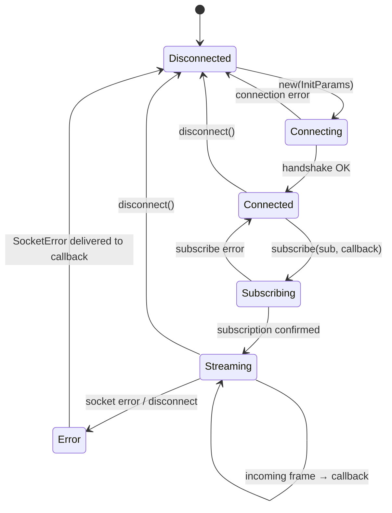

# OpenLimits — State Management

> **Last Updated**: 2026-04-07T00:00:00Z
> **Git Hash**: `4137b08`

## Overview

OpenLimits is a stateless API client at the user level: there is no persistent portfolio state or position tracker built into the library. State that does exist falls into three categories:

1. **Market info cache** — populated once at initialization, consulted on every order call.
2. **WebSocket connection state** — managed inside each `ExchangeStream` implementation.
3. **Shared data models** — the immutable value types returned by all trait methods.

## Market Info Cache

Each exchange implementation holds an `ExchangeInfo` struct that caches market pair metadata fetched from the exchange at startup.

```
Exchange struct (e.g. Binance)
├── exchange_info: ExchangeInfo    ← thread-safe cache
│   └── HashMap<String, MarketPairHandle>
│       └── MarketPairInfo { base, quote, symbol, base_increment, quote_increment, ... }
└── client: BaseClient             ← stateless HTTP client
```

**Lifecycle**:
- Populated by `refresh_market_info()` inside `Exchange::new()`.
- Read by `get_pair(market_pair)` before every order to obtain precision increments.
- Can be refreshed explicitly by calling `refresh_market_info()` again.

Source: `ext-systems/openlimits/crates/openlimits-exchange/src/traits/info/` and `ext-systems/openlimits/crates/openlimits-binance/src/lib.rs` (ExchangeInfoRetrieval impl)

## WebSocket Connection State



**Key points**:
- Each call to `subscribe()` spawns a dedicated `tokio::spawn` task that owns the stream.
- The task forwards deserialized messages to the user callback as `&Result<WebSocketResponse<R>>`.
- On disconnect or parse failure the task delivers `Err(OpenLimitsError::SocketError())` and exits.
- A `CallbackHandle` is returned; dropping it does not currently cancel the background task (v0.3.x).

Source: `ext-systems/openlimits/crates/openlimits-exchange/src/traits/stream/exchange_stream.rs`

## Core Data Models

All models live in `ext-systems/openlimits/crates/openlimits-exchange/src/model/`.

### Order

```rust
// ext-systems/openlimits/crates/openlimits-exchange/src/model/order.rs
pub struct Order {
    pub id:              String,
    pub market_pair:     String,
    pub client_order_id: Option<String>,
    pub created_at:      Option<u64>,       // Unix ms timestamp
    pub order_type:      OrderType,         // Limit | Market | Unknown
    pub side:            Side,              // Buy | Sell
    pub status:          OrderStatus,
    pub size:            Decimal,
    pub price:           Option<Decimal>,   // None for market orders
    pub remaining:       Option<Decimal>,
    pub trades:          Vec<Trade>,
}
```

### OrderStatus

```rust
// ext-systems/openlimits/crates/openlimits-exchange/src/model/order_status.rs
pub enum OrderStatus {
    New, PartiallyFilled, Filled,
    Canceled, PendingCancel, Rejected, Expired,
    Open, Pending, Active,   // Nash / Coinbase variants
}
```

### Trade

```rust
// ext-systems/openlimits/crates/openlimits-exchange/src/model/trade.rs
pub struct Trade {
    pub id:              String,
    pub buyer_order_id:  Option<String>,
    pub seller_order_id: Option<String>,
    pub market_pair:     String,
    pub price:           Decimal,
    pub qty:             Decimal,
    pub fees:            Option<Decimal>,
    pub side:            Side,
    pub liquidity:       Option<Liquidity>, // Maker | Taker
    pub created_at:      String,
}
```

### Candle (OHLCV)

```rust
// ext-systems/openlimits/crates/openlimits-exchange/src/model/candle.rs
pub struct Candle {
    pub time:   u64,     // Unix ms open time
    pub low:    Decimal,
    pub high:   Decimal,
    pub open:   Decimal,
    pub close:  Decimal,
    pub volume: Decimal,
}
```

### Balance

```rust
// ext-systems/openlimits/crates/openlimits-exchange/src/model/balance.rs
pub struct Balance {
    pub asset: String,
    pub total: Decimal,
    pub free:  Decimal,
}
```

### OrderBookResponse

```rust
// ext-systems/openlimits/crates/openlimits-exchange/src/model/request/order_book_response.rs
pub struct OrderBookResponse {
    pub update_id:      Option<u64>,
    pub last_update_id: Option<u64>,
    pub bids:           Vec<AskBid>,
    pub asks:           Vec<AskBid>,
}

pub struct AskBid {
    pub price: Decimal,
    pub qty:   Decimal,
}
```

### WebSocket Message Types

```rust
// ext-systems/openlimits/crates/openlimits-exchange/src/model/websocket.rs
pub enum Subscription {
    OrderBookUpdates(MarketPair),
    Trades(MarketPair),
}

pub enum WebSocketResponse<T> {
    Generic(OpenLimitsWebSocketMessage),
    Raw(T),
}

pub enum OpenLimitsWebSocketMessage {
    Ping,
    OrderBook(OrderBookResponse),
    Trades(Vec<Trade>),
}
```

## Request Types

All request structs live in `ext-systems/openlimits/crates/openlimits-exchange/src/model/request/`.

| Struct | Fields | Used by |
|---|---|---|
| `OpenLimitOrderRequest` | market_pair, size, price, time_in_force, post_only, client_order_id | `limit_buy`, `limit_sell` |
| `OpenMarketOrderRequest` | market_pair, size, client_order_id | `market_buy`, `market_sell` |
| `CancelOrderRequest` | id, market_pair | `cancel_order` |
| `CancelAllOrdersRequest` | market_pair | `cancel_all_orders` |
| `GetOrderRequest` | id, market_pair | `get_order` |
| `GetOrderHistoryRequest` | market_pair, paginator | `get_order_history` |
| `TradeHistoryRequest` | market_pair, paginator | `get_trade_history` |
| `OrderBookRequest` | market_pair | `order_book` |
| `GetPriceTickerRequest` | market_pair | `get_price_ticker` |
| `GetHistoricRatesRequest` | market_pair, interval, paginator | `get_historic_rates` |
| `GetHistoricTradesRequest` | market_pair, paginator | `get_historic_trades` |

## Pagination

Long result sets use the `Paginator` type:

```rust
// ext-systems/openlimits/crates/openlimits-exchange/src/model/paginator.rs
pub struct Paginator {
    pub start_time: Option<u64>,
    pub end_time:   Option<u64>,
    pub limit:      Option<u64>,
    pub before:     Option<String>,
    pub after:      Option<String>,
}
```

Each exchange crate converts `Paginator` into its own cursor format (e.g., Binance uses `from_id` + `order_id` + `start_time` / `end_time`).

## OrderFilter (Client-Side)

`get_open_orders` in `ExchangeAccount` provides a default implementation that fetches all open orders and filters them client-side using `OrderFilter`:

```rust
// ext-systems/openlimits/crates/openlimits-exchange/src/model/order_filter.rs
pub struct OrderFilter {
    pub client_order_id: Option<String>,
    pub order_type:      Option<OrderType>,
    pub market_pair:     Option<MarketPair>,
    pub side:            Option<Side>,
    pub status:          Option<OrderStatus>,
    pub created_at:      Option<Range<u64>>,
    pub price:           Option<Range<Decimal>>,
    pub remaining:       Option<Range<Decimal>>,
    pub size:            Option<Range<Decimal>>,
}
```

Source: `ext-systems/openlimits/crates/openlimits-exchange/src/traits/exchange_account.rs`

## See Also

- [architecture.md](architecture.md) — how models fit into the trait hierarchy
- [workflow.md](workflow.md) — how models flow through request/response cycles
- [development.md](development.md) — setting up a `.env` file for live or sandbox testing
